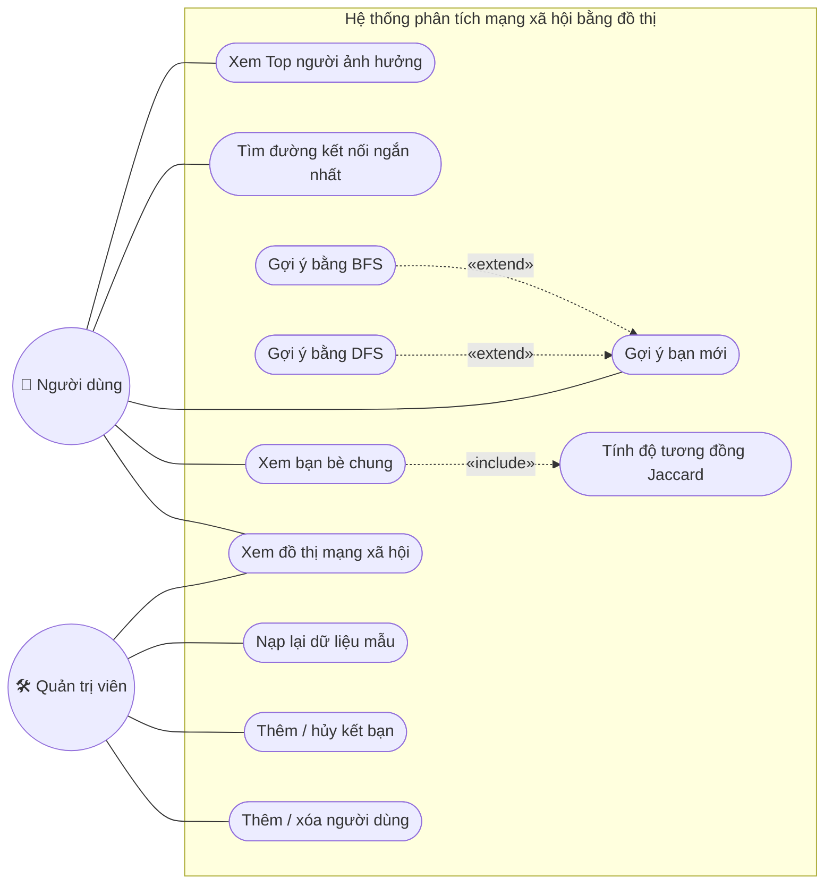
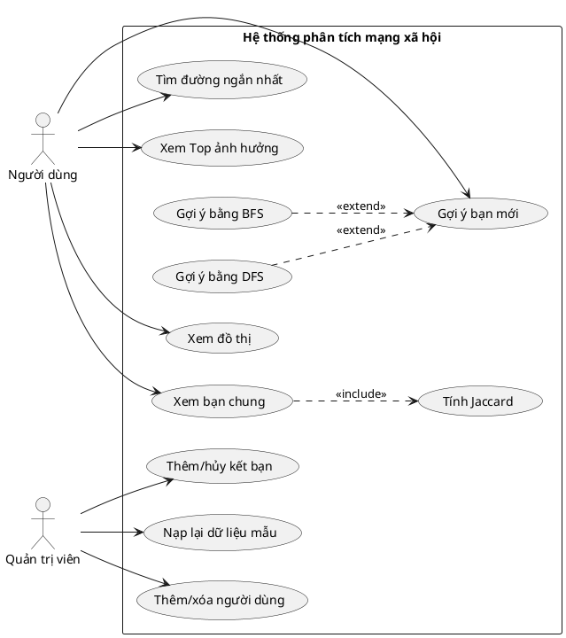
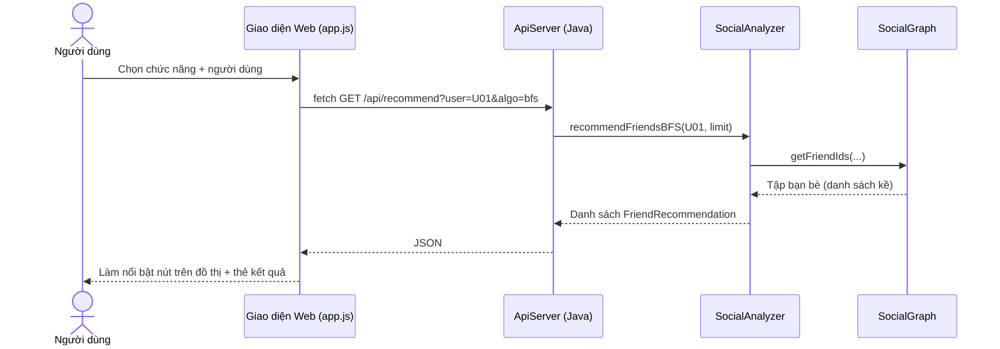
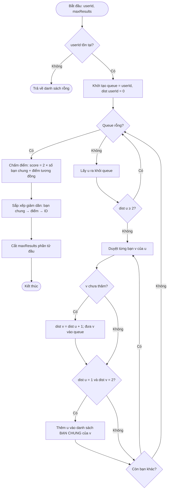
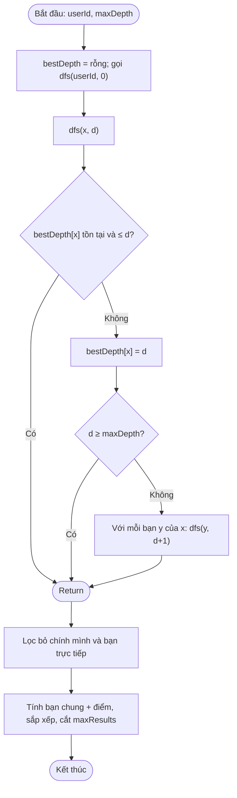
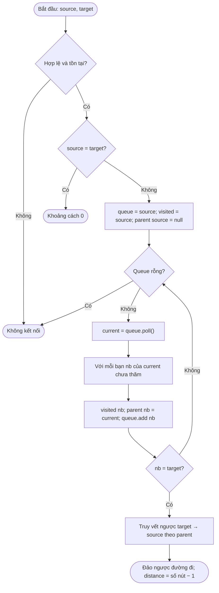

# Nội dung bổ sung cho báo cáo DOCX

> Cách dùng: dán mã Mermaid ở các mục 1–3 vào https://mermaid.live → Actions → PNG/SVG, rồi chèn vào Word. Các dòng dạng `[Chèn ảnh …]` là chỗ để dán ảnh.

---

## 1. Tác nhân (Actor) và chức năng

**Tác nhân**
| Actor | Mô tả |
|---|---|
| Người dùng (User) | Người sử dụng giao diện web: xem, phân tích, gợi ý, tìm đường |
| Quản trị viên (Admin) | Quản lý dữ liệu: thêm/xóa người dùng, thêm/hủy kết bạn, nạp lại dữ liệu mẫu |
| Hệ thống (Backend Java) | Tác nhân thứ cấp thực thi thuật toán BFS/DFS/Shortest Path trên đồ thị |

**Chức năng**: Xem đồ thị · Xem bạn chung · Tính Jaccard · Gợi ý bạn (BFS) · Gợi ý bạn (DFS) · Tìm đường ngắn nhất · Xem Top ảnh hưởng · Thêm/xóa người dùng · Thêm/hủy kết bạn · Nạp lại dữ liệu mẫu.

---

## 2. Biểu đồ Use Case

> Mermaid không có loại "use case" gốc nên dùng `flowchart` mô phỏng (actor = hình tròn, use case = hình oval).

**PlantUML (phương án thay thế – dán vào plantuml.com):**

[Chèn ảnh biểu đồ Use Case vào đây]

---

## 3. Biểu đồ luồng (Flowchart)

### 3.1. Luồng tổng quát Frontend ⇄ Backend

### 3.2. Thuật toán gợi ý bạn bằng BFS

### 3.3. Thuật toán gợi ý bằng DFS (giới hạn độ sâu)

### 3.4. Thuật toán tìm đường ngắn nhất (BFS + truy vết)

[Chèn ảnh các biểu đồ luồng vào đây]

---

## 4. Văn bản mô tả thuật toán (đưa vào Chương 2 / Chương 3)

### 4.1. Cấu trúc dữ liệu
Mạng xã hội được mô hình hóa bằng **đồ thị vô hướng không trọng số** G = (V, E): mỗi người dùng là một đỉnh, mỗi quan hệ bạn bè là một cạnh. Đồ thị lưu bằng **danh sách kề** `Map<String, Set<String>>` trong lớp `SocialGraph`; dùng `LinkedHashSet` để kiểm tra bạn bè trong O(1) và giữ thứ tự thêm vào. Thông tin chi tiết người dùng lưu ở `Map<String, User>`. Cạnh luôn được thêm/xóa **hai chiều** để bảo đảm tính vô hướng. Bộ nhớ O(V + E).

### 4.2. Xem bạn bè chung
Bạn chung của A và B là giao hai tập bạn bè F(A) ∩ F(B). Thuật toán **duyệt tập nhỏ hơn** và tra cứu trong tập lớn hơn bằng băm nên độ phức tạp là **O(min(deg A, deg B))**, thay vì sao chép và `retainAll` toàn bộ tập. Hệ số Jaccard J(A,B) = |F(A) ∩ F(B)| / |F(A) ∪ F(B)| đo mức tương đồng mạng bạn bè.

### 4.3. Gợi ý bạn mới bằng BFS
BFS xuất phát từ người dùng gốc và dừng ở **tầng 2** (bạn của bạn). Tầng 0 là chính người dùng, tầng 1 là bạn trực tiếp (loại trừ), tầng 2 là ứng viên. Khi đi từ một nút tầng 1 sang một nút tầng 2, nút tầng 1 đó chính là **một bạn chung**, nên số bạn chung được thu thập **ngay trong lượt BFS** thay vì tính lại giao hai tập cho từng ứng viên. Điểm gợi ý:

`score = 2 × (số bạn chung) + 0,5 (cùng ngành) + 0,5 (cùng quê) + 0,3 × (số sở thích chung)`

Kết quả sắp xếp giảm dần theo số bạn chung, rồi điểm, rồi ID (tie-break để kết quả xác định). Độ phức tạp **O(V + E)** cho BFS cộng O(k log k) cho sắp xếp k ứng viên.

### 4.4. Gợi ý bạn mới bằng DFS
DFS đi sâu theo từng nhánh tới độ sâu tối đa `maxDepth` để khám phá cả những người ở xa hơn bạn của bạn. Phiên bản cũ dùng một tập `visited` chung nên **kết quả phụ thuộc thứ tự duyệt**: một nút có thể bị đánh dấu thăm ở độ sâu lớn, rồi bị chặn khi gặp lại ở độ sâu nhỏ hơn, dẫn tới bỏ sót ứng viên. Phiên bản tối ưu lưu **độ sâu nhỏ nhất** `bestDepth[x]` và chỉ duyệt lại nút khi tìm được đường nông hơn. Nhờ đó tập ứng viên luôn đúng bằng mọi nút cách gốc ≤ `maxDepth` bước, và mỗi nút kèm khoảng cách thật. Mỗi nút được duyệt lại tối đa `maxDepth` lần, nên độ phức tạp **O(maxDepth × (V + E))**.

### 4.5. Tìm đường kết nối ngắn nhất
Trên đồ thị không trọng số, BFS luôn tìm ra đường đi ít cạnh nhất vì các nút được thăm theo thứ tự khoảng cách tăng dần. Mảng `parent` ghi nhận nút cha; khi gặp đích, đường đi được truy vết ngược từ đích về nguồn rồi đảo lại. Thuật toán dừng ngay khi gặp đích (early exit). Độ phức tạp **O(V + E)**. Nếu hàng đợi cạn mà chưa gặp đích, hai người ở **hai thành phần liên thông khác nhau**.

### 4.6. Các cải tiến so với phiên bản ban đầu
| # | Vấn đề | Cải tiến |
|---|---|---|
| 1 | DFS dùng `visited` toàn cục → bỏ sót ứng viên, phụ thuộc thứ tự | Lưu `bestDepth`, duyệt lại khi có đường nông hơn |
| 2 | BFS tính bạn chung bằng cách giao hai tập cho từng ứng viên | Thu thập bạn chung ngay trong BFS |
| 3 | `getMutualFriends` copy toàn bộ tập rồi `retainAll` | Duyệt tập nhỏ, tra cứu tập lớn |
| 4 | Sắp xếp không có tie-break → thứ tự không ổn định | Thêm so sánh theo ID |
| 5 | Dùng `equalsIgnoreCase` lẫn `equals` trong khi khóa Map phân biệt hoa/thường | Thống nhất `equals` |
| 6 | Jaccard không kiểm tra người dùng tồn tại; affinity có thể NPE khi thiếu ngành/quê | Thêm kiểm tra null/tồn tại |
| 7 | `subList` trả về view của danh sách gốc | Trả bản sao `new ArrayList<>` |

---

## 5. Văn bản mô tả giao diện (đưa vào Chương 3 / Chương 4)

### 5.1. Tổng quan
Giao diện web (HTML/CSS/JS thuần, không dùng thư viện ngoài) giao tiếp với backend Java qua REST API, chạy trên `http://localhost:8080`. Giao diện có ba vùng: **bảng điều khiển** (trái), **đồ thị trực quan** (giữa) và **bảng kết quả** (phải). Thanh trên cùng hiển thị thống kê: số người dùng, số kết nối, số cộng đồng (thành phần liên thông).

[Chèn ảnh chụp màn hình giao diện chính vào đây]  (`docs/screenshots/01_main.png`)

### 5.2. Đồ thị trực quan
Đồ thị vẽ bằng SVG với thuật toán bố trí lực (lực đẩy giữa các nút, lò xo theo cạnh, lực hút về tâm). Mỗi nút là một người dùng, màu theo ngành học, kích thước theo số bạn. Có thể kéo thả nút, rê chuột để xem thông tin (tuổi, ngành, quê quán, sở thích). Kết quả phân tích được **làm nổi bật trực tiếp** trên đồ thị: nút/cạnh kết quả màu xanh lục, nút được gợi ý màu hồng.

### 5.3. Chức năng Bạn chung
Chọn hai người rồi bấm **Tìm bạn chung**. Hệ thống hiển thị số bạn chung, hệ số Jaccard và thẻ thông tin từng bạn chung; đồ thị tô sáng hai người và các nút trung gian.

[Chèn ảnh chụp màn hình chức năng Bạn chung vào đây]  (`02_mutual.png`)

### 5.4. Chức năng Gợi ý bạn mới
Chọn người dùng, chọn thuật toán **BFS** (bạn của bạn) hoặc **DFS** (khám phá sâu, có thanh trượt độ sâu 2–6) và số gợi ý tối đa. Mỗi thẻ kết quả hiển thị số bạn chung, điểm gợi ý, khoảng cách và danh sách người kết nối trung gian.

[Chèn ảnh chụp màn hình gợi ý bằng BFS vào đây]  (`03_recommend_bfs.png`)
[Chèn ảnh chụp màn hình gợi ý bằng DFS vào đây]  (`04_recommend_dfs.png`)

### 5.5. Chức năng Đường kết nối ngắn nhất
Chọn người đầu và người cuối rồi bấm **Tìm đường (BFS)**. Kết quả là chuỗi người dùng nối tiếp nhau cùng số bước (độ phân cách); đường đi được vẽ nổi bật trên đồ thị. Nếu hai người ở hai cộng đồng tách biệt, hệ thống báo không có đường kết nối.

[Chèn ảnh chụp màn hình tìm đường ngắn nhất vào đây]  (`05_path.png`)

### 5.6. Chức năng Quản lý dữ liệu
Cho phép thêm người dùng mới (họ tên, tuổi, giới tính, ngành, quê quán, sở thích), thêm/hủy kết bạn, xóa người dùng cùng toàn bộ kết nối và nạp lại dữ liệu mẫu. Mọi thay đổi cập nhật ngay lên đồ thị, thống kê và bảng Top ảnh hưởng.

[Chèn ảnh chụp màn hình chức năng Quản lý vào đây]  (`06_manage.png`)

### 5.7. Bảng Top người ảnh hưởng
Xếp hạng theo Degree Centrality (số bạn trực tiếp), hiển thị thanh tỉ lệ để so sánh trực quan.

---

## 6. Kết quả thử nghiệm mẫu (dữ liệu 12 người, 15 cạnh, 2 cộng đồng)
| Thao tác | Kết quả |
|---|---|
| Bạn chung U01–U02 | 1 (Trần Thu Hà), Jaccard = 0,20 |
| Gợi ý BFS cho U01 | U06 Vũ Mai Phương (2,5), U08 Ngô Quỳnh Chi (2,5), U07 Đỗ Quang Huy (2,3), U04 Lê Hoàng Long (2,0) |
| Gợi ý DFS (depth 3) cho U01 | 4 ứng viên như BFS + U09 Bùi Quốc Anh (cách 3 bước) |
| Đường ngắn nhất U01 → U10 | U01 → U03 → U06 → U10 (3 bước) |
| Đường ngắn nhất U01 → U11 | Không có đường (khác thành phần liên thông) |
| Bộ kiểm thử tự động | 8/8 test đạt |

[Chèn ảnh kết quả chạy kiểm thử vào đây]
